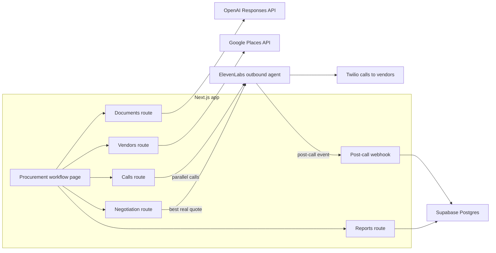

## The customer & problem

Anyone who needs a service job done (the demo is a commercial office move in Austin, TX) has to find vendors, call them one by one, explain the job again each time, and then compare quotes that are never itemized the same way. Hidden fees show up late, and a quote that looks suspiciously low is hard to spot.

AdAI is a voice procurement agent that does the calling for you and refuses to make anything up.

## What I built

- **Job-spec intake.** Upload a PDF or a photo of a job document; a vision model extracts the spec at temperature 0, the output is validated against a schema, and the customer reviews and confirms it before anything is called.
- **Vendor discovery** through Google Places: search for the service near the location, fetch details in parallel, and drop vendors without a phone number.
- **Parallel quote calls.** One ElevenLabs outbound call per vendor through its native Twilio integration, all started at once. Each call carries the job spec, the vendor name, and a versioned agent prompt with mandatory AI disclosure and a no-fabrication rule.
- **Structured quote capture.** A post-call webhook classifies each call as an itemized quote (line items plus fees plus taxes), a scheduled callback, or a decline, and stores it with a confidence score.
- **Negotiation with real leverage.** A second round of calls cites the lowest *real* competing quote, never an invented one, and records the savings.
- **Ranked report.** Quotes are sorted by total, compared to the market average, and anything under 70% of it is flagged as suspiciously low.
- Supabase auth (magic link and Google) and Postgres tables with row-level security, plus 25 unit tests on the post-call parser, client, and negotiation logic.

<Todo>Add a screenshot of the ranked-quote report, and a demo video of a real outbound call.</Todo>

## Architecture

## Key technical decisions & tradeoffs

- **ElevenLabs' native Twilio calling instead of self-hosted media streams.** Far less infrastructure, at the cost of vendor lock-in and a fully asynchronous flow where results only arrive by webhook.
- **Async, webhook-driven capture** keyed by conversation ID, with a call-type tag to tell quotes and negotiations apart. Simple and scalable, but the UI needs a realtime channel to show results as they land.
- **Anti-fabrication enforced in code, not only in the prompt.** Missing fields become empty instead of guessed, negotiation only cites real quotes, and a failed parse is reported as such.
- **The agent prompt is versioned in the repo** and sent as a per-call override, so the dashboard copy can't drift from what's reviewed in code.
- **Demo fallback on every integration** when keys are missing. Great for demos with no keys; in production it must never hide a live failure behind demo data.
- **Vertical config in JSON** (moving today), so thresholds and negotiation levers can change per industry without code changes.

## What I'd do next with a real customer deployment

1. **Run live end to end with one customer.** Push webhook results to the UI in real time so negotiation and the report unlock from live data, not demo data.
2. **Isolate failures per call** with retries and rate limits, so one bad vendor number doesn't fail the batch.
3. **Verify webhook signatures** and scope service-role writes.
4. **Check the negotiation prompt** actually uses the competing-quote variables it is sent, and add evals on recorded calls for disclosure, scope, and fabrication.
5. **Rank on more than price**: reviews, insurance, availability, and the customer's own weights.
