## The customer & problem

Support teams want AI to draft replies, but they can't let an assistant send an answer it made up, leak a customer's personal data, or promise a refund policy doesn't allow. One confident wrong answer to a customer costs more than the time AI saves. So most teams either keep AI out of customer-facing replies or review every draft by hand.

Advan is the company I founded to fix that: *the trust layer for AI customer support*. Every AI draft carries its sources, a confidence score, and a policy check, and anything the system isn't sure about goes to a person before it reaches the customer. I built the platform and ran discovery and live demos with heads of CX and VPs of Customer Success across seven verticals through design-partner rollout.

## What I built

- **Source-cited drafts.** Replies are composed from the customer's knowledge base (pgvector retrieval), and a citation engine links each answer back to the sources it used.
- **A four-signal confidence score** that weighs retrieval quality, grounding, a hallucination check (including whether the numbers in the answer appear in the sources), and policy results.
- **Human-in-the-loop by default.** Below the confidence threshold (85 by default), or whenever a policy flags a draft, the ticket workflow pauses and waits for a person's decision, with a timeout that escalates if nobody answers. Reviewers see a prioritized queue: complaints first, then low-confidence and policy-failed drafts.
- **Policy gates and privacy.** OPA/Rego policies check each draft before and after generation, and personal data is masked before anything reaches the model. A complaint classifier fails safe to human review.
- **A full audit trail.** Every decision is logged with its confidence, citations, policy checks, and who approved it.
- **Production plumbing.** Multi-tenant orgs with Google and credential sign-in, email intake, Stripe billing, an MCP server, a visual pipeline builder, and 40 test files.

## Architecture

```mermaid
%% alt: Advan architecture. A customer message goes through intake and a triage classifier, then PII masking and an OPA policy pre-check. Vector retrieval feeds an LLM composer, whose draft passes a citation and hallucination check and gets a weighted confidence score. Drafts at or above the threshold are sent automatically; drafts below it go to a human review queue, and the reviewer's decision resumes the Temporal workflow through a signal. Every outcome is written to the audit log.
flowchart LR
  A["Customer message"] --> B["Intake and triage"]
  B --> D["PII mask"]
  D --> E["OPA pre-check"]
  E --> F["Vector retrieval"]
  F --> G["LLM composer"]
  G --> H["Citation and hallucination check"]
  H --> I["Weighted confidence"]
  I -->|"at or above threshold"| J["Send reply"]
  I -->|"below threshold"| K["Human review queue"]
  K -->|"Temporal signal"| J
  J --> M["Audit log"]
```

The ticket flow runs as a Temporal workflow (triage, retrieval, compose, then a durable wait for approval), with LangGraph orchestrating the agent steps and BullMQ running embedding jobs.

## Key technical decisions & tradeoffs

- **Temporal signals for human approval, not polling.** The wait for a reviewer is durable and survives restarts, and the timeout is set per org. The cost is operating a Temporal cluster.
- **Several weak signals beat one opaque score.** Confidence is a weighted blend of four checks, renormalized over whichever signals are available, so reviewers can see *why* a draft was held.
- **OPA policies with an inline fallback.** Replies keep flowing if the policy service is down. The risk is the two rule sets drifting apart, so they need a shared test suite.
- **Ports-and-adapters core.** LLM, retrieval, and policy providers are swappable (Anthropic, Ollama, Vertex, Groq, Alibaba Model Studio), and tests run on fakes, at the cost of more layers.
- **Fail safe, not fail open.** When the complaint classifier or a parse step fails, the ticket goes to a person. Throughput is traded for trust.

## What I'd do next with a real customer deployment

1. **Calibrate the confidence threshold per customer** against their reviewers' approve and edit decisions, and report how often held drafts were actually wrong.
2. **Run the policy engine and its fallback from one rule set**, with tests that fail if they disagree.
3. **Feed reviewer edits back into retrieval** so the knowledge base fixes itself where drafts were weakest.
4. **Price on outcomes:** charge per resolved ticket, tied to resolution quality, the model I designed for Advan's design partners.
5. **Replace regex PII masking** with a proper detector before handling regulated data.
