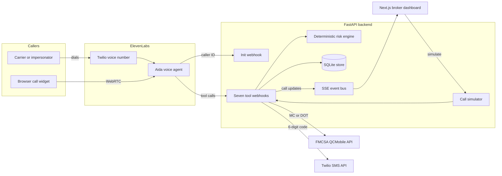

## The customer & problem

Small and mid-size freight brokerages run a carrier phone line. Their reps field dozens of carrier calls a day and can't fully vet each caller, which leaves the brokerage exposed to double brokering and carrier impersonation.

The trap is that the scammer quotes a **real** carrier's MC number. Every MC lookup passes. Today the only defense is a busy rep noticing that something feels off in the middle of a rate negotiation. A stolen load is a direct loss to the broker and to its shipper's trust.

Aida's thesis: **verify the caller, not just the MC number.**

## What I built

<YouTube id="8E9mFA73ysE" title="Aida demo: a legitimate carrier gets booked, an impersonator gets held" />

Aida is a voice agent that answers the carrier line, books loads for carriers who verify, and holds suspected impersonators for a human.

- **Seven webhook tools** the voice agent can call: `lookup_carrier`, `search_loads`, `send_verification_code`, `check_code`, `assess_risk`, `book_load`, `flag_and_handoff`.
- **FMCSA lookup** by MC docket or DOT number against the QCMobile API, with a 4-second timeout that fails closed.
- **Out-of-band verification.** A 6-digit code goes by SMS to the phone number registered with FMCSA, never to the number the caller gives. 10-minute TTL, 3 attempts, and it parses spoken digits like "oh" and "ate".
- **Deterministic risk engine** with 11 signal types (caller-ID mismatch, email domain vs carrier name, pressure language like urgency, quick-pay or off-platform payment requests) and a hard booking threshold.
- **Server-side booking gate.** `book_load` re-runs the risk engine and requires a verified code, whatever the LLM says.
- **Live broker dashboard** over server-sent events: transcript, tool-call timeline, a risk meter with per-signal weights, the carrier card, the SMS outbox, and the load board.
- **Demo resilience.** A scripted simulator (legit, impersonator, new authority) runs the same tool code, and a browser-call fallback works when the phone line or venue Wi-Fi doesn't.
- **36 pytest cases**, including assertions that the agent never receives risk reasons or registered contact details.

## Architecture

The voice stack (speech-to-text, LLM, text-to-speech, and the Twilio number) runs on ElevenLabs Agents. My FastAPI backend owns everything that matters for trust: the tools, the risk engine, and the record of each call.

Each tool call takes a per-conversation lock, syncs the transcript, runs the tool, re-scores risk, persists the call, and publishes the full call object to the dashboard.

## Key technical decisions & tradeoffs

| Decision | Why | Tradeoff |
| --- | --- | --- |
| A rules engine decides; the LLM only talks | Auditable, unit-tested, and holds up if the agent is jailbroken mid-call | Hand-set weights with no calibration data yet; English-only pressure detection |
| The agent gets only "proceed" or "hold" plus a script line | A fraudster learns nothing about which check failed | A legitimate carrier who is held gets no explanation, so every hold needs a human follow-up |
| Verification code goes to the FMCSA-registered phone, not caller ID | Caller ID is spoofable, so it only counts for part of the score | Depends on FMCSA contact data being accurate; an account takeover that changes the registered phone would defeat it |
| Voice stack hosted on ElevenLabs, backend is plain webhooks | Built in days, with native Twilio support | Vendor lock-in, and every tool call is a network round-trip that adds latency |
| Fail closed | An FMCSA error is treated as "not found", and a tool exception returns the hold script | More false holds when upstream APIs are flaky |

## What I'd do next with a real customer deployment

1. **Shadow mode first.** Run Aida alongside the brokerage's reps for two weeks, scoring calls without acting, and compare its holds with what the reps flagged.
2. **Calibrate the risk weights** on the brokerage's confirmed fraud cases, and publish a false-hold rate the ops lead signs off on.
3. **Close the loop with the TMS.** Replace the demo load board with the customer's TMS, and send the rate confirmation through it.
4. **Real handoff.** A warm transfer to an on-call rep for holds, instead of a dashboard flag.
5. **Production hardening.** Authenticate the dashboard and control APIs, require webhook secrets, and move state from SQLite and in-memory locks to Postgres and Redis so it scales past one process.
6. **Fill the data gaps.** Live QCMobile doesn't expose authority age or contact changes, so add a second data source for those signals.
