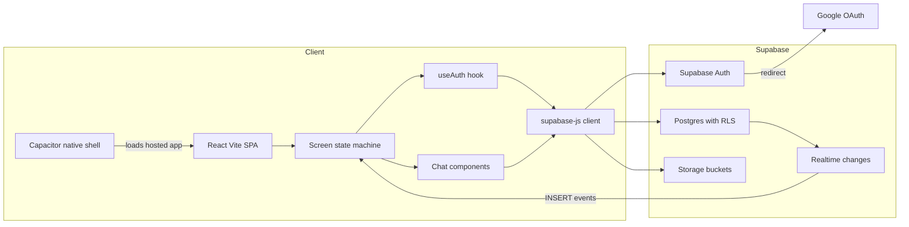

## The customer & problem

Early-stage founders need other founders: to swap advice, share resources like legal templates or cloud credits, and find people to collaborate with. That network is usually scattered across group chats, events, and LinkedIn, and none of it is built for a phone.

Connect is a mobile-first networking app for startups: network, collaborate, and explore resources in one place.

## What I built

<Demo src="/demos/connectapp" title="30-second mock walkthrough of the app with sample data" />

- **Auth**: email and password sign-up with password reset, plus Google OAuth, on Supabase Auth. A database trigger creates a profile row on sign-up.
- **Founder profiles** with a startup story, company, location, industry, and goals, plus image and video upload to Supabase Storage.
- **Startup directory** with create, edit, and delete (owner only) and search.
- **Shared resources** with categories, contacts, and search.
- **Messaging screens** (compose, conversation list, chat with edit and delete) and **realtime notifications** through Postgres change subscriptions.
- **Native shell** with Capacitor for iOS and Android.
- **Security hardening** across migrations: row-level security on every table, tightening the startup directory from public to signed-in users only, and pinning `search_path` on a security-definer function.

<Todo>Add screenshots of the app and say what part you built versus what was scaffolded with Lovable, and whether it shipped to a store or to testers.</Todo>

## Architecture

## Key technical decisions & tradeoffs

- **Supabase with RLS and no custom backend.** The client talks to the database directly and security lives in the policies. Very fast to ship; the cost is that every product rule has to be expressible as a policy.
- **A remote-URL Capacitor shell.** The app updates without store releases, but it does nothing offline and would likely face App Store review questions.
- **OAuth redirecting to the app origin.** Works on the web and in the webview; a store build needs deep-link handling for the redirect.
- **Messages modeled per user.** Keeps policies simple, but means a message isn't delivered to the recipient yet. Two-way delivery is the first thing to fix.
- **Client-created notifications** instead of database triggers, which rules out cross-user notifications for now.

## What I'd do next with a real customer deployment

1. **Make messaging two-way** with a conversation table, participant-scoped policies, and realtime on messages.
2. **Ship real native builds**: bundle the app, add deep links for OAuth, and handle offline states.
3. **Lock down storage**: private buckets with signed URLs, so profile videos respect the visibility setting.
4. **Move notifications to database triggers** so they work across users.
5. **Add matching** based on industry, stage, and goals, the feature the welcome screen promises, measured by replies rather than views.
