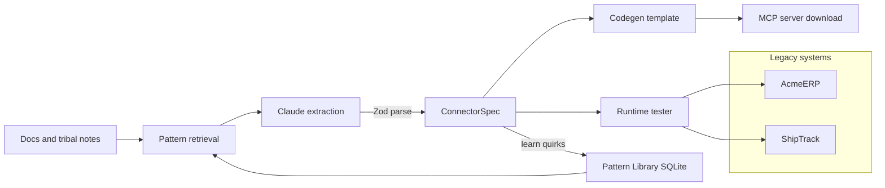

## The customer & problem

Every enterprise has a legacy system with quirks nobody wrote down. The docs say a token lasts 30 minutes; in practice it dies after three calls. Errors come back as HTTP 200 with an error flag in the body. A sync endpoint silently refuses to run during business hours. Tracking IDs only match in uppercase.

The person who hurts is the engineer building an agent connector for that system. The real spec lives in the heads of the client's engineers, and every new connector rediscovers the same kinds of quirks from scratch. That is the daily work of a forward deployed engineer.

AI Connector turns the docs plus those tribal notes into a working MCP server, tests it against the system, and remembers each quirk for the next connector.

## What I built

- **Spec extraction.** Claude reads the docs and the engineer's notes and returns a typed `ConnectorSpec`, parsed and validated with Zod. When the notes contradict the docs, the notes win.
- **Quirks as structure, not prose.** The spec has fields for each kind of quirk: silent errors, page or cursor pagination, blocked hours, parameter normalization, and re-auth on 401. Handlers enforce them in code instead of hoping the agent reads a description.
- **Deterministic codegen.** A template turns the spec into a standalone TypeScript MCP server (one tool per action, tribal rules embedded in each tool description) that you can download.
- **Try it before you ship it.** A runtime tester calls every tool against the target system and reports pass, fail, or blocked with a log, with a "Run all" button.
- **Pattern Library.** Every extracted quirk is saved to SQLite and fed back into the next extraction. In the demo, the second connector reuses three of the first connector's four learned patterns.
- **Two mock legacy systems** to prove it: *AcmeERP* (200-status errors, `?pg=` pagination, tokens that die after 3 calls, a sync locked from 9 to 5) and *ShipTrack* (`ok:false` errors, `has_next` pagination, expiring sessions, case-sensitive IDs, a hidden required `weight_kg`).
- **Offline mode.** With no API key, pre-recorded specs load so the demo runs anywhere.

## Architecture

Creating a connector runs five steps: retrieve patterns, extract the spec, generate code, save the connector, learn new patterns.

## Key technical decisions & tradeoffs

- **The LLM writes the spec, not the code.** A deterministic template generates the server, so the output always compiles and is easy to review. The tradeoff: only the quirk types in the schema can be expressed, and new kinds of quirks need a schema change.
- **Quirks are typed fields enforced by handlers.** An agent can't skip a rule it never has to read. The cost is upfront schema design.
- **The tester mirrors the codegen.** You can test inside the app before downloading anything, but the same logic lives in two places and could drift.
- **Keyword retrieval for patterns, not embeddings.** Cheap, no extra services, transparent matching; weaker on paraphrased notes.
- **Built-in `node:sqlite`.** Nothing native to compile, at the cost of requiring Node 22.13+ and single-process storage.

## What I'd do next with a real customer deployment

1. **Point it at one real client system** in a sandbox, with the client's engineer reviewing every extracted rule before codegen.
2. **Compile and run the generated server in CI** against recorded traffic, so "what you test is what you download" is proven, not assumed.
3. **Generate the runtime from the same code as the server** to remove the duplicated logic.
4. **Move pattern retrieval to embeddings** once the library is large enough for keyword matching to miss.
5. **Add a review queue for learned patterns**, so a wrong quirk from one client never leaks into another client's connector.
