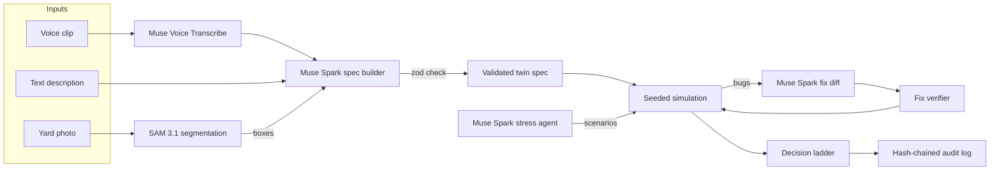

## The customer & problem

A container terminal runs on signals that disagree. The carrier's paperwork says a box is empty; the gate scale says it weighs 24 t. A reefer's sensor reads 7.5 °C while the carrier says the temperature is fine. Customs places a hold just as that box's gate lane goes down, and the free-time clock keeps running.

Terminal planners resolve these collisions by hand, under time pressure, using rules nobody ever tested against them. The cost shows up as demurrage, spoiled cargo, missed vessel windows, and trucks idling at dead lanes.

DockTwin lets a planner build a twin of the terminal in minutes and have an agent break its rules *before* a real disruption does. It was built for the Meta Global AI Developer Hackathon (Push the Frontier track, October 27 – November 4, 2026), where every model step runs on Meta models.

## What we built

<YouTube id="ZWaomFt8mq4" title="DockTwin demo: describe a terminal, get a 3D twin, and let an agent stress-test its rules" />

- **Three ways in.** Describe the terminal in text, say it out loud (Muse Voice Transcribe), or upload a yard photo (SAM 3.1 finds the boxes). Muse Spark turns any of them into a structured twin spec: objects plus `when → then` rules.
- **A safe rule language.** The spec is a small JSON DSL validated by one Zod schema, run by a pure interpreter with no `eval`. Actions follow a ladder: watch, ask, slow, reroute, inspect, hold, human.
- **Live 3D twin** of the yard, gates, and cranes, built with React Three Fiber.
- **Agent stress tests.** Muse Spark writes adversarial scenarios (paper says empty but the scale says heavy, a customs hold during a lane outage, a reefer creeping warm) and a seeded simulation finds seven kinds of bugs: conflicts, oscillation, invariant violations, policy violations, unmet expectations, dead rules, and unknown facts.
- **Proven fixes.** The agent proposes a rule diff; the engine applies it to a copy, re-runs every scenario, and marks it verified, needs review, or rejected.
- **Trust and accountability.** Each signal source carries a trust score that drops when it is contradicted, low-confidence decisions go to a human, and every decision lands in a SHA-256 hash-chained audit log.

## Architecture

## Key technical decisions & tradeoffs

- **The model proposes, the engine decides.** Muse Spark writes specs, scenarios, and fixes, but only deterministic, seeded re-simulation accepts a fix. Less model freedom, but every accepted change is reproducible.
- **A flat DSL instead of generated code.** No `eval`, and conditions have a fixed depth because Meta's structured output rejects recursive schemas. Safe and testable, less expressive.
- **Safety floors the model can't touch.** No rule can clear a customs hold, and a fix may not write a fact that an invariant reads.
- **Time budgets per call.** One deadline covers retries and repair rounds, so a slow model call fails cleanly instead of hanging the demo.
- **Graceful degradation.** If a model call fails, seeded scenarios and a heuristic fix keep the flow working; mock mode is refused in production so the live demo always makes real calls.

## What I'd do next with a real customer deployment

1. **Load one real terminal's rules** with its planners, and replay last quarter's disruptions to see which rules the agent would have caught.
2. **Calibrate trust scores** per source from the terminal's own history of contradictions instead of fixed priors.
3. **Connect live feeds** (gate scales, reefer telemetry, customs status) so the twin runs on the same signals the planners see.
4. **Have operations leads set the safety thresholds**, which are prototype assumptions today.
5. **Export verified rule changes** into the terminal's operating system as reviewed change requests, with the audit log attached.
