## The customer & problem

The users are agent developers and benchmark evaluators on AgentBeats, the agent-evaluation platform behind Berkeley RDI's AgentX–AgentBeats competition. Their problem: when an agent answers a benchmark question, you usually can't see *how* it got there, and you can't rerun it and get the same result. That makes scores hard to trust and hard to debug.

This project turns static GAIA-style math problems into executable, traceable agent workflows: problem → plan → tool calls → verification → answer, with every phase logged.

## What I built

<Demo src="/demos/gaia-green-agent" title="30-second mock demo: plan, act, and verify on sample tasks" />

- **Plan.** A rule-based planner turns a word problem into steps, handling sequential phrasing ("first X, then Y", "after that") by passing the previous result forward.
- **Act.** Each computation step runs through a calculator built on Python's `Decimal` with 50 digits of precision, using a hand-written tokenizer and precedence parser instead of `eval`.
- **Verify.** Each step is checked before the next runs, with bounded retries, and the final answer is normalized and validated.
- **Score.** Answers are graded by exact, numeric (1e-6 tolerance), or partial match, and combined into a composite of accuracy, execution quality, format, and self-verification.
- **Trace.** Every phase writes structured JSON, plus a per-run summary.
- **Packaging.** Docker images, a compose file for the green and purple agents with resource limits, and a GitHub Actions workflow that publishes images tagged with the commit SHA.

<Todo>Add real run results (accuracy on a sample set), the AgentBeats submission or leaderboard link, and the competition track. The repo also needs cleanup: the task loader, config, sample data, and requirements.txt are referenced but not committed.</Todo>

## Architecture

```mermaid
%% alt: GAIA green agent architecture. A CLI with YAML config wraps GAIA tasks and runs a batch loop. For each prompt, the regex planner produces steps, the step executor sends expressions to the Decimal calculator, and the verifier checks each step with retries before the final answer check. The scorer grades the answer and writes task and summary JSON. A separate purple HTTP server can delegate to the planner.
flowchart LR
  subgraph Runner["eval runner"]
    CLI["CLI and YAML config"]
    Batch["run_batch loop"]
  end
  Wrap["GAIATask wrapper"]
  subgraph Agent["GAIAAgent execute"]
    Plan["Regex planner"]
    Act["Step executor"]
    Calc["Decimal calculator"]
    Ver["Verifier and retry"]
    Ans["Final answer check"]
  end
  Score["Scorer"]
  Out["Task and summary JSON"]
  Purple["Purple HTTP server"]
  CLI --> Wrap --> Batch
  Batch -->|"prompt"| Plan --> Act
  Act -->|"expression"| Calc --> Ver
  Ver -->|"next step"| Act
  Ver --> Ans --> Score --> Out
  Purple -.->|"delegates"| Plan
```

## Key technical decisions & tradeoffs

- **A rule-based planner instead of an LLM.** Offline, free, and fully deterministic, so any run can be reproduced exactly. The tradeoff is coverage: it handles arithmetic phrasing, not the web, file, and multimodal questions in the full GAIA benchmark.
- **A custom Decimal parser instead of `eval` or a CAS.** Safe (no code execution) and exact (no float error). It supports the four operations and parentheses only.
- **Explicit phases with a JSON log for each.** Every answer can be audited step by step, which is the point of the project.
- **A composite score instead of pass/fail.** More informative, but self-verification shouldn't earn credit on its own, and partial matches need stricter rules before the score is trusted.
- **Solver and scorer in one process** instead of a green agent assessing a remote purple agent over A2A. Simpler to reproduce, but not yet the full AgentBeats assessor pattern.

## What I'd do next with a real customer deployment

1. **Make the repo build from a clean clone**: commit the missing loader, config, sample data, and pinned requirements, and make CI run real tests.
2. **Split the roles properly**: the green agent assesses a remote purple agent over the official A2A protocol, so any agent can be benchmarked.
3. **Add an LLM planner behind the same verify phase**, keeping the deterministic calculator as the tool, and compare both on the same traces.
4. **Tighten scoring**: no credit for self-verification alone, and stricter normalization for non-numeric answers.
5. **Pin everything** (image digests, dependency lockfile) so "reproducible" holds a year from now.
