## The customer & problem

Freight brokers lose loads to double brokering and carrier identity theft. The scammers follow a pattern: a fresh MC number, a Gmail address, a VoIP phone, a bid well under market, and a request to switch to WhatsApp or change the payment details.

Brokers already have vetting tools, but they are **static rule lists**. When one broker catches a scammer, nothing changes for the next broker that same scammer calls with a new MC number and the same phone. The tools don't learn from what brokers confirm.

## What I built

<Video src="/work/lanewatch/demo.mp4" title="60-second narrated Lanewatch demo" />

Lanewatch scores a carrier call, explains the score, and gets better each time a broker confirms what really happened.

- **8 call signals:** new MC authority (under 90 days), free email domain, VoIP phone, a bid 15% or more below market, a payment or factoring change request, urgency language, moving the call to text or WhatsApp, and an identifier already flagged by the network.
- **Explainable score.** A logistic model turns the signals into a probability and a road-sign verdict: *Hold the load* or *Safe to book*. The active signals are listed as reasons, ordered by weight.
- **Learns from outcomes.** When the broker clicks *Confirm fraud* or *Confirm legit*, the model takes one online gradient step, and every weight bar shows how much it moved.
- **Network memory.** Confirming fraud adds the caller's phone, email, and MC to a blocklist, normalized so formatting tricks don't slip through.
- **Honest metric.** Accuracy is prequential: each prediction is stored *before* the update, so the number isn't graded on data the model already learned from.

In the demo, a subtle scam scores about 38% and slips under the threshold. The broker confirms fraud. The same scammer calls back with a new MC number and the same phone, and now scores about 89%: *Hold the load*.

<Shot src="/work/lanewatch/desktop.png" alt="Lanewatch after a confirmed fraud: 89% Hold the load, the network-flag reason, weight bars showing the +0.31 update, and the learning log" width={1425} height={1511} />

## Architecture

Everything runs in one HTML file in the browser: no backend, no API keys, no build step.

```mermaid
%% alt: Lanewatch architecture. A call form or demo preset feeds signal extraction, which uses transcript regex rules and the network blocklist. Signals go to a logistic score and a verdict. The broker's confirmation drives an online SGD update and, for fraud, adds identifiers to the blocklist. All state persists in localStorage and is shown in the network memory panel.
flowchart LR
  B["Broker"] --> P["Demo call presets"]
  B --> F["Call form and transcript"]
  P --> F
  F --> X["Extract 8 signals"]
  R["Transcript regex rules"] --> X
  BL["Network blocklist"] -->|"exact ID match"| X
  X --> S["Logistic score"]
  S --> V["Verdict sign and reasons"]
  V --> C["Confirm fraud or legit"]
  C -->|"label minus p"| U["Online SGD update"]
  C -->|"fraud only"| BL
  U --> LS["localStorage state"]
  BL --> LS
  LS --> M["Network memory panel"]
```

The model is `p = sigmoid(b + Σ wᵢxᵢ)` over binary signals. On confirmation, each active weight moves by `0.5 × (label − p)`.

## Key technical decisions & tradeoffs

- **A logistic model instead of an LLM.** The score is fully explainable, because the reasons *are* the weights. The tradeoff is that the starting weights are hand-set priors, not fit on data.
- **One SGD step per confirmation, with a high learning rate.** Each confirmation visibly changes the model, which is the point of the product. In production that same learning rate makes the model order-sensitive and easy to poison, so it would need bounds and review.
- **Regex rules for transcript signals.** They are deterministic and auditable, but brittle: "we don't use WhatsApp" still fires the off-platform signal.
- **The blocklist matters most.** On the repeat-scammer call, the shared identifier flag drives most of the jump in score. That is the real moat: memory shared across brokers.
- **A single static file.** Anyone can open it and try it in seconds. The cost is that the "network" lives in one browser's `localStorage`.

## What I'd do next with a real customer deployment

1. **Make the network real.** A shared service and database for the blocklist and model, with per-broker auth and an audit trail of who confirmed what.
2. **Pull signals instead of typing them.** Authority age from FMCSA, phone type from a carrier-lookup API, and the transcript from the call system (Aida is the natural front end).
3. **Fit the priors** on a labeled set of the customer's past fraud cases, and report calibration, not just accuracy.
4. **Guard the learning loop.** Weight bounds and regularization, dedupe repeated confirmations of the same call, and a second reviewer for any label that adds to the shared blocklist.
5. **Replace keyword rules** with a small classifier that handles negation and paraphrase, keeping the per-signal explanation.
