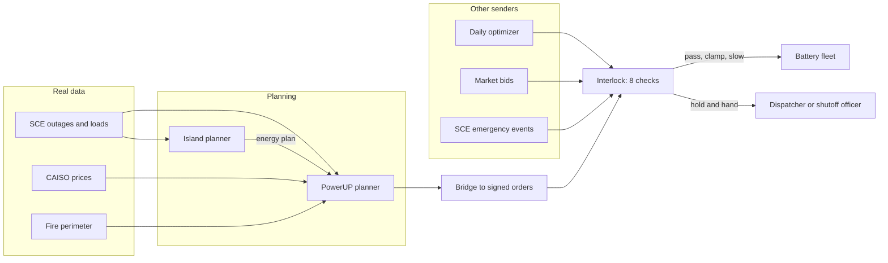

## The customer & problem

The customer is a company that owns and runs a fleet of home batteries (Base Core: 39.2 kWh, 20 kW). Its dispatcher's worst day is when the grid itself is the disaster: Southern California Edison cuts power to a circuit for wildfire risk (a Public Safety Power Shutoff), sometimes for days.

Two things go wrong on that day:

- **The batteries aren't full for the right people.** A home on Medical Baseline (oxygen, refrigerated medicine) needs every kWh; a normal trading schedule may have sold that charge the afternoon before.
- **The fleet's own software becomes the disaster.** Orders arrive from many senders at once: the daily optimizer, a market bid, a utility emergency event, a vendor cloud. Any of them can be stale, forged, or unsafe for the line it lands on, like exporting onto a de-energized line or recharging everything at once when the circuit comes back.

PowerUP was built by a team of four for the InnovateLA Dual-Use Hackathon at USC (October 16–18, 2026), Energy & Grid Hardening track with Base Power.

<Todo>Add your own role on the team. The repo's team section doesn't list it yet.</Todo>

## What I built

Three parts that share one escalation ladder: *watch, ask, slow, hold, hand to a person*.

- **PowerUP planner** (`pilot/app/`): for a shutoff that comes with warning. It fills batteries by risk, Medical Baseline homes first, budgets each home's hours through the outage, staggers the recharge so restoring a circuit doesn't overload it, and leaves the go-ahead to the utility's shutoff officer.
- **Interlock guard** (`interlock/`): for failures that come without warning. Every order passes eight ordered checks (shape, auth, freshness, precedence, backup floor, inverter, circuit, ramp) and gets the gentlest rung that keeps each home's backup and the circuit safe. It can only shrink, slow, or stop an order, never create or enlarge one. It also works out *why* a battery went quiet and never counts a silent battery as capacity.
- **Island planner** (`islands/`): when a shutoff cuts a whole circuit but only part of it is risky, it finds the homes that are dark only because their feed runs through a risky stretch, and plans an opt-in neighborhood island behind SCE's existing switches.

The live demo replays the real October 2026 Malibu shutoff on the 456 homes behind SCE switch RAR8848, with six injected failures (a replayed order, a stolen key posing as SCE, a market export onto a dead line, a 20 kW recharge rebound). In that replay, with a simulated fleet of 189 battery homes:

| Same shutoff, same orders | Guard off | Guard on |
| --- | --- | --- |
| Battery homes that go dark | 189 of 189 | 0 |
| Medical Baseline homes that go dark | 16 of 16 | 0 |
| Fleet charge when the power goes off | 9% | 99% |
| Battery-hours pushing power onto a de-energized line | 567 | 0 |

Every number in the app is labeled real (SCE outage and load records, CAISO prices, the NIFC fire perimeter), assumed (battery adoption, circuit limits, rates), or simulated (the fleet, the failures). `npm test` runs 60 checks.

## Architecture

PowerUP never talks to a battery directly. The reserve it plans for each home becomes the floor Interlock enforces against every sender, including PowerUP's own optimizer and the utility.

## Key technical decisions & tradeoffs

- **One guard for every sender, including our own.** PowerUP's orders go through Interlock like anyone else's. Wiring the two together exposed a real bug: an order validly signed days earlier could be re-sent and skip the freshness check, so Interlock now treats it as a replay once the order's window has closed.
- **The guard can only reduce.** Interlock never creates, enlarges, or flips an order. That keeps its failure mode safe, at the cost of never fixing a bad plan, only containing it.
- **The gentlest rung that works.** Instead of pass/fail, each check picks watch, ask, slow, hold, or hand, so a slightly risky order is slowed rather than blocked. In the evening replay, the guarded fleet keeps every backup promise and still earns 1.19× the unguarded one.
- **A priority tier, never a medical record.** PowerUP sees only that a home is Medical Baseline, which limits the privacy and abuse surface.
- **Signatures are a stand-in.** The demo uses a deterministic hash, clearly labeled; a real deployment needs asymmetric signatures (as in IEEE 2030.5 / OpenADR 3 over TLS).
- **A second layer, not a replacement.** IEEE 1547 anti-islanding should already trip a battery on a dead line; Interlock assumes that can fail and guards anyway.

## What I'd do next with a real customer deployment

1. **Run Interlock in shadow mode** on the customer's live order stream for a few weeks: log what it would have held or clamped, and review every hold with the dispatch team before it can act.
2. **Replace the signature stand-in** with per-sender certificates and asymmetric signatures.
3. **Get real circuit ratings** from the utility (SCE publishes loads, not ratings) so the circuit and ramp checks use true limits.
4. **Pilot the island plan with the utility** on one switch, starting with the hard rules (never re-energize risky overhead line, one grid-forming source) as a utility-reviewed checklist.
5. **Use the same guard every day** as a test bench: replay each new dispatch policy through Interlock, then roll it out to 1%, 10%, and 100% of the fleet.
