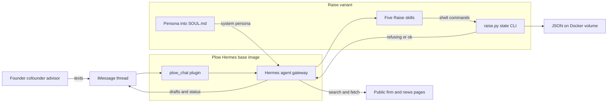

## The customer & problem

Pre-seed founders spend hours building investor lists, writing intros, and keeping a pipeline up to date, usually while also building the product. AI research tools make the list faster but introduce a worse problem: they invent investors, deals, and contact details, and a founder who emails a hallucinated "fit" loses credibility fast.

Fundraising is also a team sport. Co-founders and advisors all weigh in, but not everyone should be able to approve what goes out.

## What I built

<YouTube id="iiCXKVhJFuA" title="Raise demo: researching investors and approving an intro in a shared iMessage thread" />

Raise is a fundraising associate the founding team texts over iMessage, built on OpenClaw 2.0 (the Plow Hermes base agent) during a hackathon.

- **Onboarding** collects a seven-field startup profile two or three questions at a time.
- **Grounded investor research.** The agent searches the web and opens firm, portfolio, and news pages. It keeps a candidate only if a page it opened shows a pre-seed or seed focus and at least one relevant deal with a year, and every investor record must carry a source URL. A short honest list beats a padded one.
- **Intro drafts** of 120 words or less that open with the stored fit or deal, saved for review.
- **Pipeline** with stages from researched to replied, every change logged with who made it and when.
- **Monthly update drafts** that use only numbers the team gave.
- **Multiplayer threads.** The owner, co-founders, and advisors share one thread. Anyone can ask for research or status, but only the owner or a co-founder can approve a draft, and the role comes from the platform's roster, never from what someone claims in chat.

## Architecture

## Key technical decisions & tradeoffs

- **A thin variant on a digest-pinned base image** instead of building an agent runtime. It shipped within the hackathon and builds reproducibly, at the cost of platform lock-in and no control over the model or search provider.
- **Rules live in a deterministic CLI, not just the prompt.** `raise.py` is the only way to change state, and it refuses invalid moves (no source URL, a duplicate investor, marking "contacted" before approval). The weak point: the approver's role is a string the model passes in, so the gate still trusts the model to read the roster honestly.
- **Draft-only, humans send.** No email integration and no auto-send, which removes spam and reputation risk at the cost of automation.
- **Roles from the platform roster, not self-claims.** The core multiplayer design, covered by a smoke test that an advisor is refused and a co-founder is accepted.
- **Flat JSON with atomic writes** instead of a database: simple and persistent, but one startup per deployment and no concurrency control.

## What I'd do next with a real customer deployment

1. **Verify sources in code**: fetch each stored URL and check it supports the claim, instead of trusting a prompt rule.
2. **Bind approval to the platform identity** directly, so the role check can't be influenced by the model.
3. **Add evals on research quality**: the share of investors whose source actually supports the fit, measured on real founder threads.
4. **Move to a real store** with per-team isolation, locking, and history, and connect the CRM the team already uses.
5. **Instrument latency and cost per research run** before scaling to more teams.
