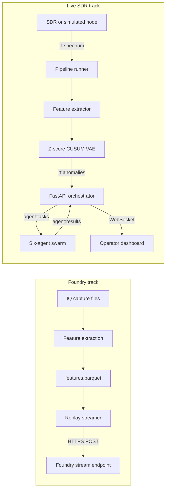

## The customer & problem

IoT telemetry, SCADA links, and drone and tactical radio links in the 433, 868, and 915 MHz bands can be jammed, replayed, or spoofed with a cheap software-defined radio. Security operations tools watch the network layer and are blind to the physical layer, and spectrum analyzers need an expert watching them.

The target user is the operator responsible for those links: they need an alert that says *this channel is being jammed*, not a waterfall plot to interpret. RF-Sentinel was built for the National Security Hackathon (2026) on Foundry's free hackathon tier.

## What I built

Two tracks that share one detection idea.

**Foundry ML data pipeline**

- **IQ loader** for the common capture formats (`.npy`, `.cfile`, SigMF, HDF5, MATLAB v7.3), aimed at the public IMEC 802.11ah captures.
- **Feature extraction** on 100 ms windows: 12 spectral features (power stats, frequency centroid, RMS bandwidth, spectral flatness, SNR, crest factor, zero-crossing rate, phase variance), plus rolling means, z-scores, and deltas: 29 features in all.
- **Labeled anomalies** injected on top of benign captures: jamming (power up, flatness up, SNR down), spoofing (centroid offset), and frequency drift.
- **Streaming replay** into the Foundry Streams API in batches, with periodic attack injection, a dry-run mode, and failures counted instead of crashing the stream.

<Demo src="/demos/rf-sentinel" title="30-second mock demo with simulated spectrum data: jamming, spoofing, and drift being flagged" />

**Live SDR track**

- Simulated, USRP, and HackRF nodes publish spectrum frames to Redis.
- A detector combines z-scores, CUSUM on the frequency centroid, and a VAE's reconstruction error, and labels the anomaly type.
- An agent layer triages each anomaly (signal ID, decode, geolocation, threat mapping to MITRE ATT&CK for ICS, response), with hard frequency-band guardrails on any LLM guess.
- A FastAPI orchestrator streams everything to an operator dashboard over WebSocket.

<Todo>Add a screenshot of the Foundry Workshop dashboard or the operator dashboard, and the trained model's metrics. The model card's metric tables are still empty in the repo.</Todo>

## Architecture

## Key technical decisions & tradeoffs

- **Inject labeled attacks onto real benign IQ.** Labels arrive instantly, which is the only way to train a classifier inside a hackathon. The risk, stated in the model card, is that a model learns the injection signature rather than real attacks.
- **No-code model training in Foundry** instead of training code in the repo. It is fast to iterate and is where the operator's dashboards live, but there is no reproducible training artifact outside the platform.
- **Batched HTTP replay to simulate a stream.** Simple and resilient, but it sets a floor of a few seconds of alert latency.
- **Unsupervised detection on the live track.** Z-score, CUSUM, and VAE need no labels, and the baseline only updates on frames judged normal so an attacker can't slowly teach it a new normal. Hand-tuned noise floors trade sensitivity for fewer false alarms.
- **Graceful degradation everywhere.** Simulated nodes, a mock event bus, and LLM-to-local fallbacks keep a demo running without hardware. The cost is that it must be obvious in the UI when output is simulated.
- **Deterministic guardrails on LLM output.** Protocol guesses are checked against band tables, which limits hallucinated answers at the cost of maintaining those tables.

## What I'd do next with a real customer deployment

1. **Get real attack captures** from the customer's own environment or a red-team exercise, and evaluate against the ship gate in the model card (macro F1 ≥ 0.85, per-class recall ≥ 0.80) on held-out *time ranges*, not a random split.
2. **Fix the data leaks first.** Stop streaming ground-truth label fields to the dashboard, and make drift injection time-contiguous.
3. **Wire the trained model into the live track**, so the operator sees one score rather than two systems.
4. **Model the assets in the Ontology** (sites, links, radios) so an alert names the affected link and its owner.
5. **Measure alert latency end to end** and move from batched replay to a true streaming source if the customer's response time needs it.
