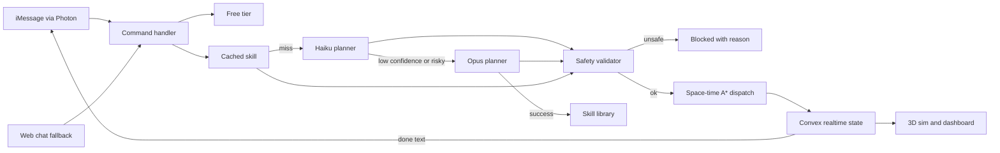

## The customer & problem

Warehouse operators want to direct robots in plain language: "move pallet from Dock A to Rack 3". Putting a frontier model behind every command makes that easy, and expensive: most commands are routine, yet each one pays frontier prices. A model planning physical work can also be confidently wrong, sending a robot into a human zone or overloading it.

SpecBot asks: what if the fleet's "brain" were only as expensive as each command needs, and nothing a model plans could reach a robot without passing plain-code safety checks? It was built from an empty folder during the Night Hack (October 2026).

## What I built

- **Text the fleet over iMessage.** Register your phone on the site, text a command, and a robot carries it out live in a shared 3D warehouse. SpecBot texts back which brain planned the task and what it cost, then texts again when it's done. A web chat fallback runs the same handler.
- **A cost-aware router** for every command:
  - **Free:** help and status, no model call.
  - **Cache:** learned skill templates, $0.
  - **Cheap:** Claude Haiku 5.5 with prompt caching.
  - **Frontier:** Claude Opus 5.5, only when a command is novel, risky, low-confidence (under 0.7), or fails validation.
- **A deterministic safety validator** checks every plan, whatever tier wrote it: payload limits, forbidden human zones, battery level, unknown robots or locations. Unsafe requests come back *blocked* with a plain-English reason.
- **The fleet gets cheaper with use.** Successful frontier plans are turned into parameterized skills, so the next similar command hits the cache.
- **Honest cost accounting.** Every call logs the real input, output, and cache tokens from the API; the "all-frontier" baseline is the measured average of the first three frontier tasks, not an estimate.
- **Server-authoritative simulation.** Space-time A* with cell reservation means robots never share a cell or swap head-on, and every viewer sees the same fleet. Commands work even with no browser open.
- **Live robot specs.** Firecrawl scrapes the MiR250 spec page and Claude extracts payload, speed, and battery for the validator, with a bundled fallback profile.

## Architecture

## Key technical decisions & tradeoffs

- **Escalate, don't default to the biggest model.** Most commands never reach Opus. The tradeoff is latency and cost on escalated commands, which pay for both the cheap and the frontier call.
- **Models plan, code decides.** The validator is plain code with no model in the loop, so a jailbroken or confused plan still can't send a robot into the human zone.
- **Measure the baseline instead of assuming it.** Savings are computed from real token usage against measured frontier runs; until three samples exist, the dashboard says "measuring" rather than showing a made-up number.
- **The server owns the simulation.** Paths are stored as timed waypoints and every browser interpolates them, so judges' texts and every viewer see one consistent fleet.
- **Re-fetch webhooks instead of trusting them.** Photon doesn't document webhook signing yet, so the handler only takes the message ID and re-fetches the message with its own key; forged deliveries can't inject commands, and duplicates are dropped.

## What I'd do next with a real customer deployment

1. **Connect one real fleet's API** behind the same validator, starting with read-only status, then single-robot moves under supervision.
2. **Tune the escalation threshold** on the customer's own command log, tracking cost per task and the rate of plans the validator rejects.
3. **Put a human approval step** in front of risky or multi-robot plans before they dispatch.
4. **Add role-based access**, so only registered operators can command the fleet, with an audit trail of who sent what.
5. **Expire and re-validate skills** when the warehouse layout or robot specs change.
